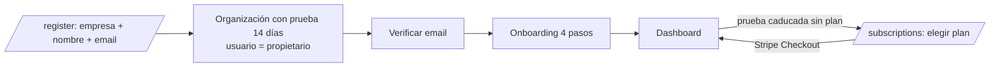

# 01 · Alta, cuentas, planes y equipo

**Estado:** 🟢 P0 resueltos · Tests: `tests/Feature/Audit/SaasReadinessTest.php`, `tests/Feature/Auth/RegistrationTest.php`

## Flujo

## Hallazgos

| ID | Prio | Hallazgo | Evidencia | Estado |
| --- | --- | --- | --- | --- |
| P0-1 | P0 | Bucle de redirecciones en el alta: el usuario nuevo no tenía empresa y `/onboarding` redirigía a sí mismo | `EnsureOrganization` + rutas | ✅ El alta crea la empresa; `/organization/create` para cuentas sin empresa |
| P0-2 | P0 | La prueba gratis caducada no bloqueaba nada | sin middleware | ✅ `EnsureActiveSubscription` (`SUBSCRIPTION_ENFORCE`) |
| 1.3 | P1 | No había forma de añadir usuarios al equipo (y el paso 3 del onboarding lo exigía) | no existía | ✅ Ajustes → Equipo: invitar (email para crear contraseña) y quitar; límite por plan (`users_limit`) |
| 1.4 | P1 | La página pública de precios anunciaba 29/79/199 € y 20 coches; la configuración cobra 29/99/299 € con 10 coches | `PricingPublic.vue` vs `config/subscription.php` | ✅ La página lee precios y límites de la configuración |
| 1.5 | P1 | Mensajes de límite de plan en inglés | `PlanLimitMiddleware` | ✅ En español |
| 1.6 | P1 | Ajustes de empresa a medio traducir; `currency`/`locale` no se guardaban (no estaban en `$fillable`) | `Organization/Edit.vue`, `Organization` | ✅ |
| 1.7 | P2 | Roles solo owner/operator, sin permisos finos | `User::role` | Aparcado |
| 1.8 | P2 | Invitación por email con contraseña elegida por el invitado (hoy se usa el enlace de «restablecer contraseña») | `OrganizationTeamController` | Aparcado |

## Pendiente para ti

- Crear los precios en Stripe y rellenar `STRIPE_PRICE_*` y `STRIPE_WEBHOOK_SECRET`.
- Si se instala para un solo cliente sin cobro: `SUBSCRIPTION_ENFORCE=false`.
