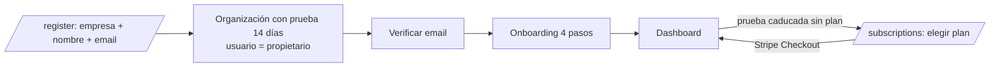

# 01 · Alta, cuentas, planes y equipo

**Estado:** 🟢 P0 resueltos · Tests: `tests/Feature/Audit/SaasReadinessTest.php`, `tests/Feature/Auth/RegistrationTest.php`

## Flujo

## Hallazgos

| ID | Prio | Hallazgo | Evidencia | Estado |
| --- | --- | --- | --- | --- |
| P0-1 | P0 | Bucle de redirecciones en el alta: el usuario nuevo no tenía empresa y `/onboarding` redirigía a sí mismo | `EnsureOrganization` + rutas | ✅ El alta crea la empresa; `/organization/create` para cuentas sin empresa |
| P0-2 | P0 | La prueba gratis caducada no bloqueaba nada | sin middleware | ✅ `EnsureActiveSubscription` (`SUBSCRIPTION_ENFORCE`) |
| 1.3 | P1 | No había forma de añadir usuarios al equipo (y el paso 3 del onboarding lo exigía) | no existía | ✅ Ajustes → Equipo: invitar (email para crear contraseña) y quitar; límite por plan (`users_limit`) |
| 1.4 | P1 | La página pública de precios anunciaba 29/79/199 € y 20 coches; la configuración cobra 29/99/299 € con 10 coches | `PricingPublic.vue` vs `config/subscription.php` | ✅ La página lee precios y límites de la configuración |
| 1.5 | P1 | Mensajes de límite de plan en inglés | `PlanLimitMiddleware` | ✅ En español |
| 1.6 | P1 | Ajustes de empresa a medio traducir; `currency`/`locale` no se guardaban (no estaban en `$fillable`) | `Organization/Edit.vue`, `Organization` | ✅ |
| P0-8 | P0 | Cashier trataba al `User` como cliente de Stripe; las suscripciones son de la organización → cancelar, cambiar de plan y webhooks fallaban. Además se consultaba la suscripción `default` y se crea como `main`: quien paga figuraba «sin suscripción» (y el bloqueo de prueba caducada le habría cerrado la app) | `Subscription::owner()` = `null`; `Organization::hasActiveSubscription()` | ✅ `Cashier::useCustomerModel(Organization)`, tipo único `Organization::SUBSCRIPTION_TYPE` · test `BillingIntegrityTest` |
| P0-9 | P0 | Los webhooks sobrescribían los manejadores de Cashier sin llamarlos: altas, cambios y bajas hechas en Stripe no llegaban a la tabla `subscriptions` | `StripeWebhookController` | ✅ Llaman primero a Cashier y luego ajustan el plan · test de cancelación desde Stripe |
| 1.9 | P1 | Al suscribirse se regalaban otros 14 días de prueba (14 del alta + 14 de la suscripción) | `SubscriptionController::create` | ✅ Solo los días que queden de la prueba |
| 1.10 | P1 | Página de planes del panel en inglés («Current Plan», «/month», «cars», «Subscribe») y descripciones para «talleres» | `Subscriptions/Index.vue`, `config/subscription.php` | ✅ En español y para importadores |
| 1.11 | P1 | Los usuarios nuevos se creaban con idioma `en` (valor por defecto de la columna) aunque la app sea en español: el selector marcaba EN | migración `add_locale_to_users_table` | ✅ El alta, las invitaciones y el seeder usan el idioma de la app |
| 1.12 | P1 | El onboarding decía «Bienvenido a Laravel» si `APP_NAME` no está configurado | `HandleInertiaRequests` | ✅ Nunca se muestra «Laravel» |
| 1.13 | P1 | La organización propietaria (y Enterprise) veía el anuncio «¿Necesita más funciones? Ver planes» | barra lateral | ✅ Oculto |
| 1.14 | P1 | Eliminar la cuenta del último propietario deja la empresa huérfana **con la suscripción de Stripe cobrando** | `ProfileController::destroy` | Pendiente (M): impedirlo y añadir «Eliminar empresa» (cancela la suscripción y borra los datos) |
| 1.15 | P1 | El webhook dice deduplicar eventos 24 h, pero libera el bloqueo al terminar: solo evita duplicados simultáneos | `StripeWebhookController::handleWebhook` | Pendiente (S) |
| 1.7 | P2 | Roles solo owner/operator, sin permisos finos | `User::role` | Aparcado |
| 1.8 | P2 | Invitación por email con contraseña elegida por el invitado (hoy se usa el enlace de «restablecer contraseña») | `OrganizationTeamController` | Aparcado |

## Pendiente para ti

- Crear los precios en Stripe y rellenar `STRIPE_PRICE_*` y `STRIPE_WEBHOOK_SECRET`.
- Si se instala para un solo cliente sin cobro: `SUBSCRIPTION_ENFORCE=false`.
