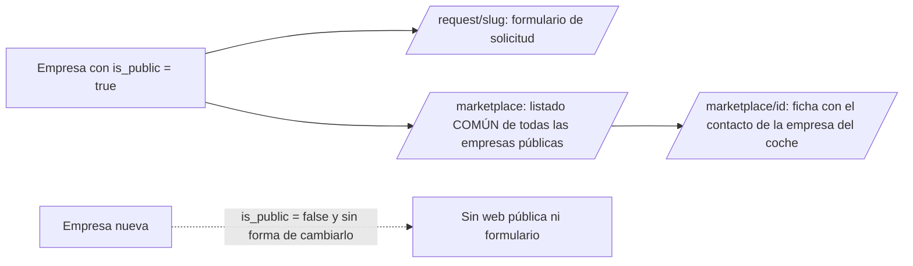

# 06 · Web pública, marketplace, dossier y PDF

**Estado:** 🔴 decisión de producto pendiente (D1)

## Cómo funciona hoy

## Hallazgos

| ID | Prio | Hallazgo | Evidencia | Estado |
| --- | --- | --- | --- | --- |
| P0-11 | P0 | Testimonios inventados («Carlos M., Dealer · Madrid»…) en la portada del producto | `Welcome.vue` | ✅ Retirados |
| P0-12 | P0 | Ninguna empresa nueva puede activar su web pública: `is_public` solo se cambia en la base de datos. Si se activa, sus coches entran en el listado común `/marketplace`, cuya portada lleva el contacto de la empresa operadora | `PublicCarRequestController`, `Car::scopePublicMarketplace`, `MarketplaceLayout` | ⏳ D1 |
| 6.4 | P1 | Afirmaciones sin respaldo en portada y registro: «80 % menos tiempo», «3x rotación», «IA 24/7», «90 % de accuracy», «Soporte por email y chat», «marketplace público por organización» (hoy no existe) | `i18n/es.js` (`welcome.*`, `auth.*`) | ⏳ D2 |
| 6.5 | P1 | «Compatible con tus fuentes favoritas: mobile.de, autoscout24…» puede leerse como integración oficial con esos portales | `Welcome.vue` | ⏳ D2: «Analiza anuncios de…» |
| 6.6 | P1 | La portada del producto habla de «concesionario» y «talleres»; el producto es para importadores | `welcome.*` | Revisar copy (S) |
| 6.2 | P1 | Folleto PDF estático de JJ (`public/jj-import-folleto.pdf`); solo se muestra a la organización operadora | ver 03 · 3.1 | Pendiente (M) |
| 6.7 | P1 | La regla de honorarios «1.000 € / 1.500 € si ≥ 30.000 €» está fija en el código (`CostBreakdown`, `MarketModel::costePuestoEnHuelva`) y en la sección «Transparencia» | `app/Support/CostBreakdown.php` | Pendiente (M): honorarios por empresa |
| 6.3 | P2 | schema.org solo de la operadora | ✅ sale de su perfil | — |

## Plan para D1 = (a) web por empresa (recomendado)

| Paso | Qué | Esfuerzo |
| --- | --- | --- |
| 1 | Ajustes → «Web pública»: activar/desactivar, ver y copiar los enlaces | S |
| 2 | `/m/{slug}`: listado de coches de esa empresa (reutiliza `MarketplaceIndex` filtrando por organización y su marca) | M |
| 3 | `/marketplace` queda como la web de la organización operadora (JJ) | S |
| 4 | Tests de aislamiento: los coches de una empresa no aparecen en la web de otra | S |
