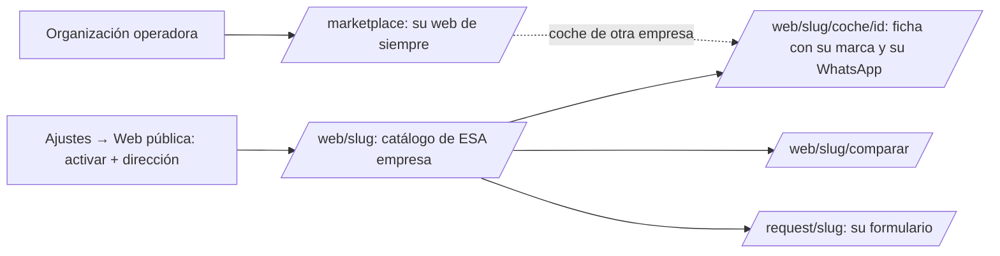

# 06 · Web pública, marketplace, dossier y PDF

**Estado:** 🟢 web pública por empresa hecha (D1 = a, 22-oct-2026)

## Cómo funciona ahora

| Regla | Dónde |
| --- | --- |
| Cada web solo muestra los coches publicados de su empresa | `PublicMarketplaceController::siteCars()` |
| La web se ve si está activada **y** la cuenta está al día (la operadora no paga) | `PublicSite::isAvailable()` |
| `/marketplace/{id}` de un coche de otra empresa redirige (301) a su web | `PublicMarketplaceController::show()` |
| `/web/{slug-de-la-operadora}` redirige a `/marketplace` (una sola URL por catálogo) | `siteIndex()` |
| Marca, logo, WhatsApp, aviso legal y formulario salen de la empresa | `PublicSite::context()` → `marketplace` prop |
| Visitas a la portada contadas por empresa (`organizations.web_visits`) | migración `2026_10_23_100000` |
| El pie «¿Eres importador? Conoce la plataforma» se oculta en Enterprise | feature `custom_branding` |
| Sitemap con la web y las fichas de cada empresa; sin coches de webs apagadas | `SitemapController` |
| Panel: «Mi web pública» en el menú, dashboard y ficha del coche apuntan a la web del usuario | prop compartido `publicSite` |

Tests: `tests/Feature/Audit/CompanySiteTest.php` (15).

## Hallazgos

| ID | Prio | Hallazgo | Evidencia | Estado |
| --- | --- | --- | --- | --- |
| P0-11 | P0 | Testimonios inventados («Carlos M., Dealer · Madrid»…) en la portada del producto | `Welcome.vue` | ✅ Retirados |
| P0-12 | P0 | Ninguna empresa nueva podía activar su web pública y, si se activaba, sus coches entraban en `/marketplace` con el contacto de la operadora | `PublicCarRequestController`, `Car::scopePublicMarketplace`, `MarketplaceLayout` | ✅ web por empresa |
| 6.4 | P1 | Afirmaciones sin respaldo en portada, precios y registro: «80 %», «3x», «IA 24/7», «90 % de accuracy», «soporte por chat», «SLA 99,9 %», «account manager», «vehículos ilimitados», cifras de clientes (142 vehículos, 18k de margen), FAQ que prometía verificar el VIN y exportar a CSV, comparativa de planes inventada | `i18n/*.js`, `Welcome.vue`, `GuestLayout.vue`, `PricingPublic.vue` | ✅ retiradas; planes y límites salen de `config/subscription.php` (`PlanCatalog`). Test `HonestMarketingTest` |
| 6.5 | P1 | «Compatible con tus fuentes favoritas: mobile.de, autoscout24…» podía leerse como integración oficial | `Welcome.vue` | ✅ «La skill para Claude investiga anuncios en…» |
| 6.6 | P1 | La portada hablaba de «concesionario» y «talleres» | `welcome.*` | ✅ |
| 6.2 | P1 | Folleto PDF estático de JJ (`public/jj-import-folleto.pdf`); solo se muestra en la web de la operadora | `PublicSite::context()['brochureUrl']` | Pendiente (M): folleto por empresa |
| 6.7 | P1 | La regla de honorarios «1.000 € / 1.500 € si ≥ 30.000 €» está fija en el código (`CostBreakdown`, `MarketModel::costePuestoEnHuelva`) y en la sección «Transparencia» | `app/Support/CostBreakdown.php` | Pendiente (M): honorarios por empresa |
| 6.3 | P2 | schema.org solo de la operadora | ✅ sale de su perfil | — |

## Pendiente (P2)

| ID | Qué | Esfuerzo |
| --- | --- | --- |
| 6.8 | Dominio propio por empresa (`coches.miempresa.com` → su `/web/slug`) | M |
| 6.9 | La lista de favoritos/comparador del visitante es común a todas las webs del mismo dominio (localStorage); el comparador ya ignora coches de otra empresa | S |
| 6.10 | Mejorar la IA de cara al cliente en la web (anunciado por ti para más adelante) | — |
